# FUSE

**Compiling heterogeneous secure-computing task graphs onto one reconfigurable datapath.**


Secure computing rarely arrives one domain at a time. A privacy-preserving
model-serving endpoint must answer each request, encrypt what it was given and
what it returns, and prove that the data behind the answer is what it claims:
dense tensor work, a block cipher and a zero-knowledge proof, interleaved
within one request. FUSE is a compilation framework that maps such task graphs
onto a single reconfigurable fabric and rebinds the fabric between domains at
the granularity of the work they share. Zero-knowledge proofs, machine learning
and classical cryptography are the domains evaluated here; the method assumes
nothing about a domain beyond a multi-stage pipeline.

<p align="center">
  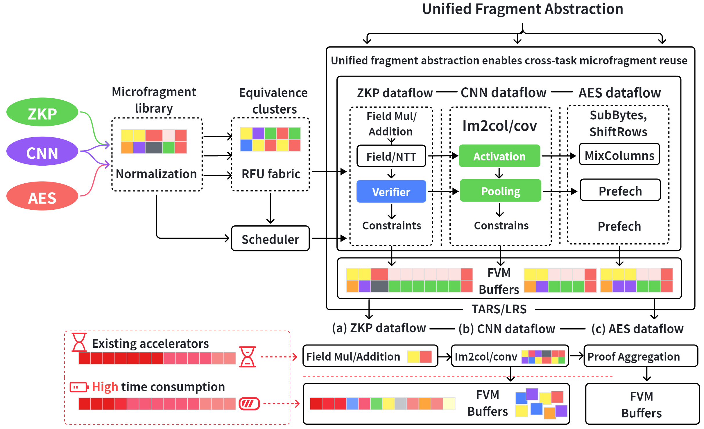
</p>

<p align="center"><sub>Each task is decomposed into microfragments, normalized into structural classes and scheduled onto one RFU fabric. (a) ZKP, (b) CNN and (c) AES dataflows over shared FVM buffers. Bottom: an existing accelerator runs each task end to end, while FUSE shares microfragments across tasks.</sub></p>

## Contents

- [How FUSE works](#how-fuse-works)
- [Key results](#key-results)
- [Repository layout](#repository-layout)
- [Quick start](#quick-start)
- [Which engine](#which-engine)
- [Reproducing the paper](#reproducing-the-paper)
- [Language-model evaluation](#language-model-evaluation)
- [Review and reproduction notes](#review-and-reproduction-notes)

## How FUSE works

The three domains look unalike and are built alike: each is a multi-stage
pipeline whose stages repeat the same data regions and computation paths.

<p align="center">
  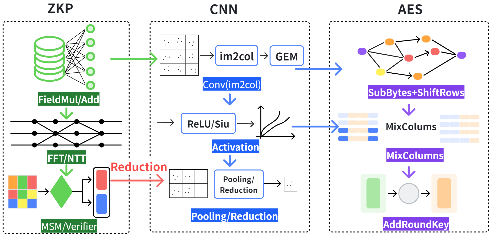
</p>

FUSE rests on one observation: *configuring the fabric for a fragment requires
agreement on its shape alone, while returning a result for it requires
agreement on its operands.* Every fragment is normalized, and two hashes are
computed over the normal form:

| Hash | Blind to | Authorizes | Crosses a domain boundary? |
|---|---|---|---|
| structural `H_s` | operand names, literals, numeric width | pinning a template family, reusing a datapath configuration | **yes** |
| value `H_v` | nothing | returning a cached result | **never** |

A cached result is returned only where operands agree and the run-time
contracts **C1–C4** pass (adaptable context, bit-exactness, FP tolerance, and
request identity), which no two domains ever satisfy. The pieces that compile
to hardware:

<p align="center">
  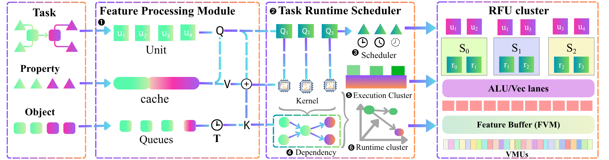
</p>

- **RFU** – reconfigurable functional units, rebound at fragment granularity.
- **LRC** – lightweight reconfiguration controller; pins template families and retires them on a freshness window.
- **FVM** – feature vector manager; keeps state resident across a task boundary and holds the result cache.
- **TARS** – the scheduler; prefers a fragment whose result is cached to one whose template is merely pinned.

## Key results

All hardware numbers are cycle-level simulation from the C++ engine; the CPU
and GPU baselines are measured. Each domain-specific baseline is granted a
datapath advantage on its own domain, so every FUSE overhead below is an upper
bound.

| Question | Result |
|---|---|
| One fabric against the specialists | within **1.05×** of the modeled domain-specific accelerator on VGG16, AES-128 and six language models (0.12–7.6 B); **1.28×** on Groth16, whose baseline is a fully static pipeline |
| Mixed ZKP/CNN/AES pipeline vs. multi-core | **71 %** lower scheduling latency, **38 %** fewer reconfiguration events, **59 %** fewer switching cycles |
| Cost of a cross-domain switch | **0.063 ms**, 42× below a CPU task transition and 37× below a GPU's |
| Reconfiguration avoided (ablation) | **6.80×** faster than the same fabric reconfiguring at every fragment, on the 16k-constraint Groth16 circuit |
| Private language-model serving | the AES and Groth16 work a request owes costs at most **0.2 %**; the shared array finishes **1.18×** sooner than its best fixed partition at 16 RFUs |
| Language models as the request compiler | a hosted model compiles a service correctly; canonicalization turns four wordings of one service into one job |

<table>
<tr>
<td width="50%">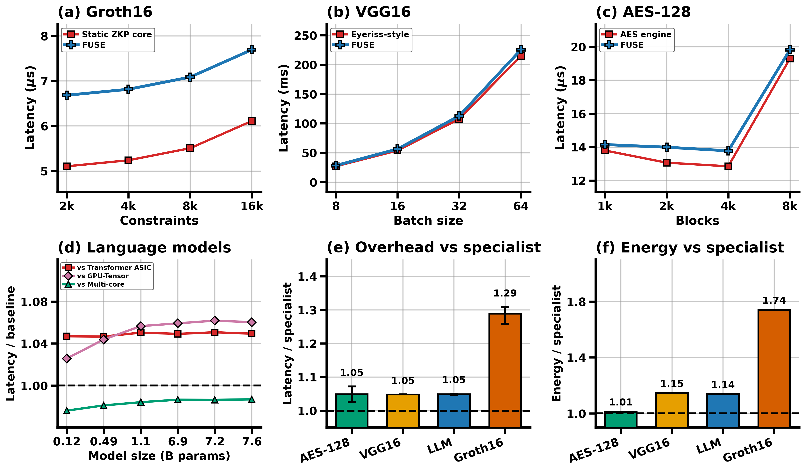<br><sub><b>Against the specialists.</b> Latency of FUSE against an accelerator built for each domain.</sub></td>
<td width="50%">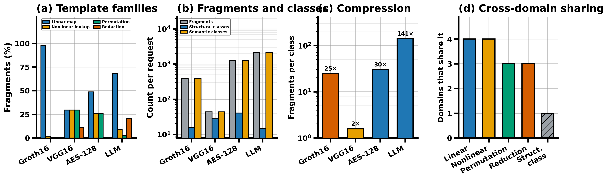<br><sub><b>What is shared.</b> Template families cross all four domains; structural classes cross none.</sub></td>
</tr>
<tr>
<td>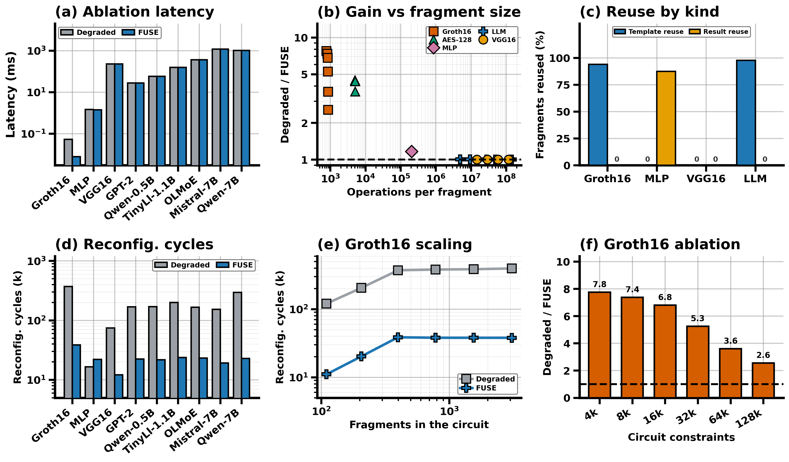<br><sub><b>Ablation.</b> FUSE against a build with template pinning and the value cache off; the gain falls with work per fragment.</sub></td>
<td>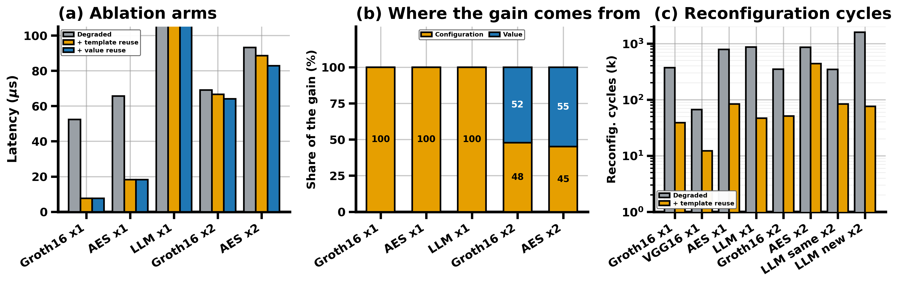<br><sub><b>The reuse chain.</b> A third arm keeps pinning and drops only the value cache, splitting the gain into its two halves.</sub></td>
</tr>
<tr>
<td>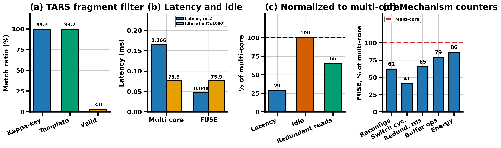<br><sub><b>Scheduling.</b> Dispatch latency and switch events on a mixed pipeline against a multi-core platform running the same trace.</sub></td>
<td>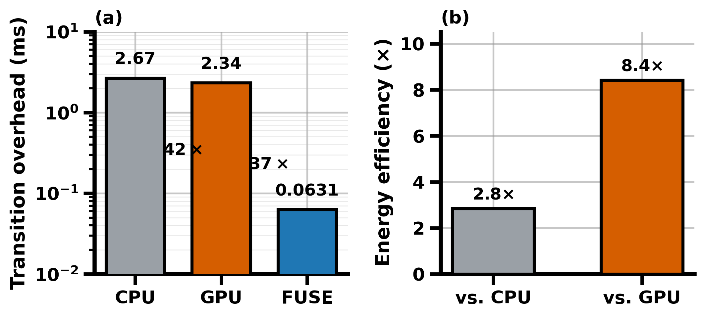<br><sub><b>Reconfiguration.</b> Cost of a cross-domain switch against CPU and GPU task transitions.</sub></td>
</tr>
<tr>
<td>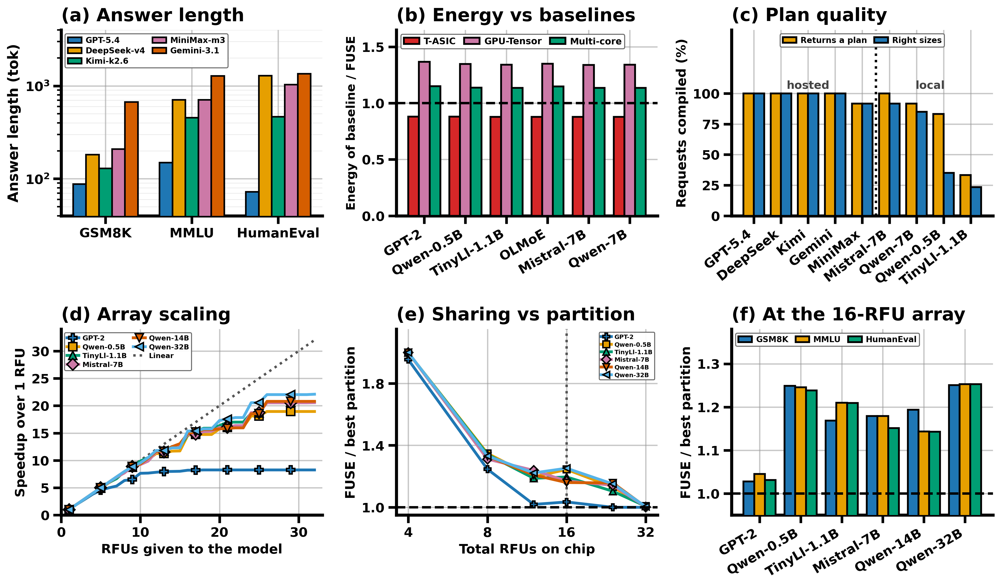<br><sub><b>Language models.</b> Six models against a transformer ASIC, a tensor core and a multi-core system.</sub></td>
<td>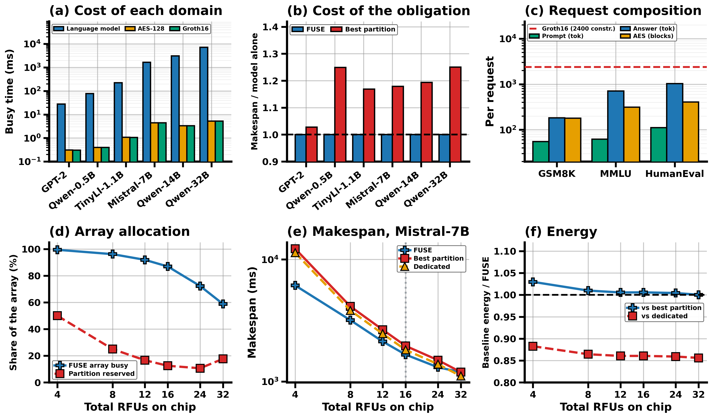<br><sub><b>Secure serving.</b> Model, AES and Groth16 in flight at once on one array, against the best fixed partition.</sub></td>
</tr>
<tr>
<td>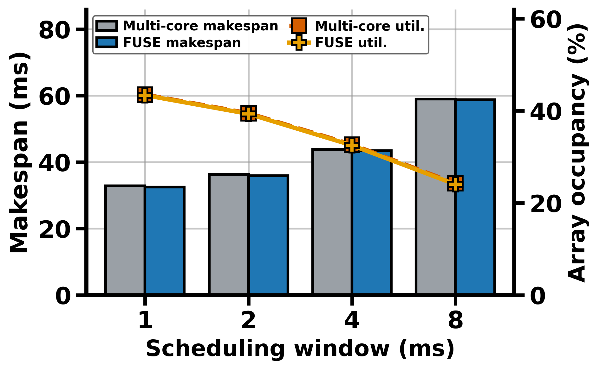<br><sub><b>Mixed pipeline.</b> Utilization and makespan with the three domains interleaved.</sub></td>
<td>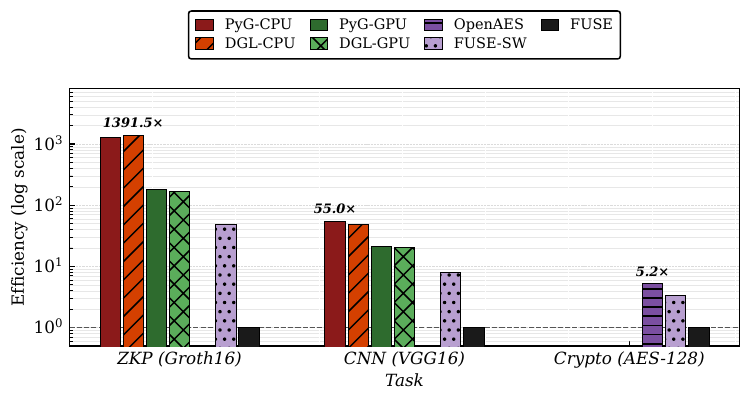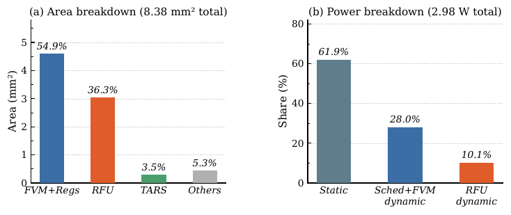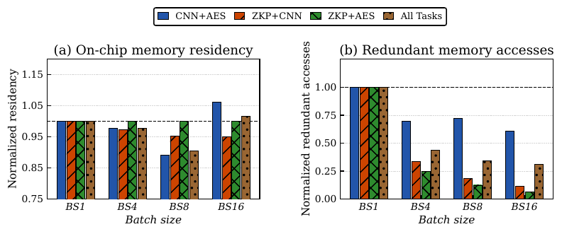<br><sub><b>Energy, area and power, memory.</b> From DRAMsim3, CACTI and the OpenROAD / DC reports.</sub></td>
</tr>
</table>

## Repository layout

```text
configs/            calibration and tool configuration
cpp/                C++ engine (the engine of record): engine, CSV I/O, models
rtl/                Verilog for RFU, FVM, LRC, TARS and the top level, with a testbench
scripts/            command-line entry points (benchmarks, ablations, LLM studies, plots)
src/fuse/           Python package: fragments, normalizer, reuse decision, scheduler,
                    workloads, Python engine (sim/), evaluation drivers
tests/              regression tests (pytest)
results/            every stored scenario with the input tables it was simulated from
runs/               language-model evaluations: llm_zoo, llm_frontend, concurrent, concurrent_levels, census
figures/ reports/   rendered figures; memory, area and timing reports
openroad_results/   OpenROAD flow outputs and manifests
openroad_work/
deliverable/        packaged copy of an earlier snapshot of the above, for reviewers
external/           vendored DRAMsim3, CACTI and OpenROAD-flow-scripts
docs/img/           the images in this README
```

## Quick start

```bash
python -m pip install -r requirements.txt
python -m pip install -e .
python scripts/build_cpp.py                      # builds cpp/build/ with g++ or cl
python scripts/run_benchmarks.py --engine cpp    # writes results/
pytest -q                                        # 85 tests
```

Python 3.10 or newer; Windows, Linux or macOS. A CUDA GPU is needed only for
the language-model measurements.

## Which engine

Two simulators implement the same model: the C++ engine in `cpp/` and the
Python engine in `src/fuse/sim/`. **Every number in the paper and in
`results/raw` comes from the C++ engine.** The two do not agree numerically,
so a run that falls back to Python will not match the published figures.
`run_benchmarks.py` warns on stderr when that happens; set
`FUSE_REQUIRE_CPP=1` to make it an error instead. Every metrics file records
which engine produced it in its `engine` row.

To confirm the C++ engine still reproduces the published results, from the
exact input tables stored beside them:

```bash
python scripts/verify_cpp_repro.py            # all 103 stored scenarios
python scripts/verify_cpp_repro.py --pattern fig4
```

## Reproducing the paper

| Paper section | What it measures | Produce the data | Draw the figure |
|---|---|---|---|
| §4.2 Against the specialists | latency per domain vs. its accelerator | `run_benchmarks.py --engine cpp` | `plot_bold_figures.py --only domains` |
| §4.2 What is shared | template families and structural classes per domain | `run_template_census.py` → `runs/census/` | `plot_bold_figures.py --only reuse` |
| §4.2 Ablation, granularity, circuit growth | gain against the degraded build | `run_granularity_ablation.py --offline`, `sweep_zkp_ablation.py` | `plot_bold_figures.py --only ablation` |
| §4.2 The reuse chain | configuration half vs. value half | `run_reuse_breakdown.py --offline` | `plot_bold_figures.py --only chain` |
| §4.4 Scheduling and reconfiguration | dispatch latency, switch events, switch cost | `run_benchmarks.py` (fig11*, fig12 CSVs) | `plot_bold_figures.py --only sched`, `plot_reconfig.py` |
| §4.4 Mixed pipeline | utilization and makespan | `run_benchmarks.py` | `plot_bold_figures.py --only mixed` |
| §4.3 Language models | zoo, serving, request compiler | see below | `make_llm_tables.py`, `plot_bold_figures.py --only secure/concurrent` |
| Appendix A.4 Sensitivity | baseline advantage sweep | `run_sensitivity.py` | `make_sensitivity_table.py` |
| Energy, area, memory | DRAMsim3, CACTI, OpenROAD | `run_dramsim3_flow.py`, `run_cacti_flow.py`, `run_openroad_flow.py` | `plot_paper_figures.py` |

`plot_bold_figures.py` writes PDF and PNG into `sosp/` by default; pass
`--out-dir` to put them elsewhere. `REPRODUCTION_NOTES.md` has the complete
command list and `EXPERIMENT_COVERAGE.md` the full set of studies.

## Language-model evaluation

```bash
# six real local models on GSM8K, then FUSE against the baselines
python scripts/run_llm_zoo_eval.py --output-root runs/llm_zoo --offline

# language models as the request compiler (hosted models need a gateway)
export FUSE_LLM_GATEWAY="https://<your-gateway>"
export FUSE_LLM_TOKEN="<your-token>"
python scripts/run_llm_frontend_eval.py --output-root runs/llm_frontend

# the model plus its obligatory AES and Groth16 work, all concurrent
python scripts/run_concurrent_eval.py --output-root runs/concurrent --offline

# regenerate the paper tables, macros and figures from the results
python scripts/make_llm_tables.py --zoo runs/llm_zoo --frontend runs/llm_frontend \
    --concurrent runs/concurrent --out-dir sosp
```

The zoo needs a CUDA GPU with roughly 16 GB for the 7B models; pass `--models`
to select a subset, `--no-native` to skip the GPU measurement, and
`--reuse-native` to re-simulate against measurements already on disk.
Measurement and simulation are separable, so after a change to the engine the
simulation half can be redone from what is in `runs/` without a GPU or a
gateway:

```bash
python scripts/run_llm_zoo_eval.py --output-root runs/llm_zoo --reuse-native --no-native --offline
python scripts/resimulate_llm_frontend.py          # replays runs/llm_frontend/frontend_replies.csv
python scripts/run_concurrent_eval.py --offline --answer-lengths runs/concurrent/answer_lengths.json
```

Gateway credentials come from the environment and are never stored in the
repository; `--no-gateway` runs the local models alone.

## Review and reproduction notes

To facilitate paper review and code reproduction, the repository carries the
evaluation outputs alongside the code. `results/` holds every stored scenario
with the input tables it was simulated from (`scripts/verify_cpp_repro.py`
replays all of them), `runs/` holds the language-model evaluations, and
`figures/`, `reports/`, `openroad_results/` and `openroad_work/` hold the
rendered figures and the memory, area and timing reports. `deliverable/` is a
packaged copy of an earlier snapshot of these for reviewers. The CPU and GPU
baselines were measured on an Intel Xeon Platinum 8470Q and an NVIDIA RTX 5080;
everything else is simulation and runs on any machine with a C++ compiler. The
released artifacts rely on open-source infrastructure vendored under
`external/`: [DRAMsim3](https://github.com/umd-memsys/DRAMsim3) for
memory-system evaluation, [CACTI](https://github.com/HewlettPackard/cacti) for
cache and buffer modelling, and
[OpenROAD-flow-scripts](https://github.com/The-OpenROAD-Project/OpenROAD-flow-scripts)
for physical-design reporting. On Windows, clone with
`git config --global core.longpaths true` set first; `external/` contains paths
longer than the default limit.
